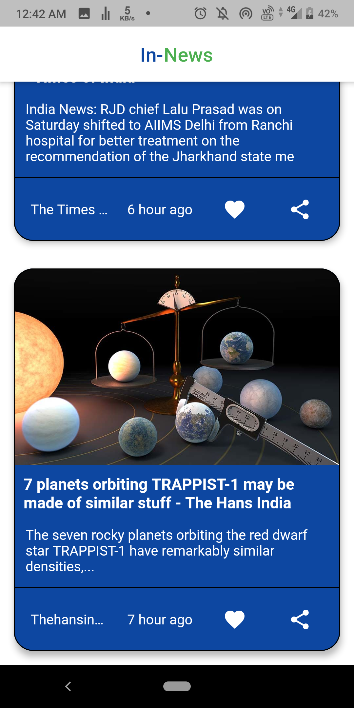

# News App

A new Flutter application which show live news

## Description

With the help of this app you can read live news from any categories:

* Business 
* Entertainment
* General
* Health
* Science
* Sports
* Technology

### Installing required packages

1. Clone this repository
   ```
    git clone https://github.com/akashlilhare/news_app.git
   ```

2. Set current working directory to `news_app`

3. Run these commands:
   ```
   flutter pub get
   flutter pub upgrade
   flutter pub outdated
   ```

4. Run the app with a NewsAPI key (the app reads it from `--dart-define` so secrets do not need to be committed):
   ```
   flutter run --dart-define=NEWS_API_KEY=your_newsapi_key
   ```

#### This will install all the required packages

## Screenshots
<p align="middle">
  
  
  
  
</p>
 
 ### Contributions are always welcome!!

